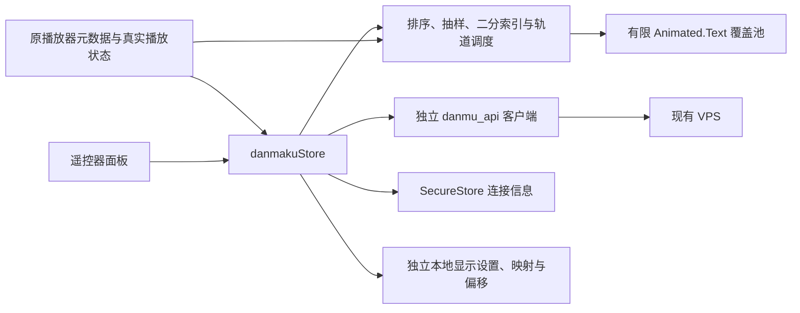

# Android TV 外部弹幕

本分支为 `feature/android-tv-danmaku`，基于 OrionTV 1.3.14 / `41c7a600`。保留 Expo 51、React Native TV 0.74.2 和 Expo AV 14.0.7；未升级或替换播放器内核。仅面向 Android TV，独立包名为 `com.oriontv.danmaku.dev`。

## 架构

- `services/danmaku/api.ts`：请求、错误归一化、取消、合并在途请求、会话缓存、弹幕解析。
- `matching.ts` / `media.ts`：电影、真实季集标签和保守匹配；区分影视身份、季集身份及播放源身份。
- `timeline.ts`：视频秒内公平抽样、独立同屏上限、去重、二分跳转、独占轨道。
- `storage.ts`：专用存储命名空间，连接加密，显示与映射独立保存。
- `stores/danmakuStore.ts`：自动/手动匹配、请求世代、保存队列和失败降级。
- `components/danmaku/`：覆盖组件、播放器/全局设置面板、连接输入。

现有 `Video` 仍使用 Expo AV 的 TextureView。覆盖层位于视频之后、原控制栏之前，不响应指针或遥控器焦点。视频组件使用 memo，弹幕加载不驱动整个视频组件重渲染。设置面板也与高频播放进度更新隔离，避免重绘整组遥控器按钮。

## API 协议

支持 `https://主机`、`https://主机/TOKEN`、`https://主机/TOKEN/api/v2`。单独输入 Token 时不重复追加同一个 Token。推荐根域名与普通 Token 分开填写；不要使用 ADMIN_TOKEN。

| 请求 | 参数 / 返回 |
|---|---|
| POST `/api/v2/match` | JSON `{fileName}`；验证 `success/isMatched/matches` |
| GET `/search/anime` | `keyword`；返回 `animes` |
| GET `/search/episodes` | `anime`；客户端提供此协议方法 |
| GET `/bangumi/:animeId` | 使用兼容 API 的数值 **animeId**，返回 `bangumi.episodes` |
| GET `/comment/:episodeId` | `format=json&duration=true`；返回 `comments/videoDuration` |

`bangumiId` 可能是腾讯等站点自己的字符串 ID，不能代替 `animeId` 调用详情接口。真实服务对“庆余年第二季”的搜索返回 360、tencent、aiyifan、animeko；360 和腾讯的实际剧集接口均返回正常。包装层的 `seasons.name` 可能统一写成 `Season 1`，不能把它当作真实第一季；客户端使用影视元数据与作品标题中的真实季数。

弹幕规范化为 `{id,time,text,color,mode}`：time 为秒，mode 为 scroll/top/bottom。`p` 的模式 1/4/5 对应滚动/底部/顶部，颜色为十进制 RGB。丢弃无效时间、空内容、过长内容及不支持模式，按时间排序；单次最多解析 150,000 条。

请求超时 45 秒；网络失败和 502/503/504 重试一次。401/403、JSON/格式错误不反复重试。相同在途请求共享结果；取消一个消费者不影响其他消费者，最后一个退出后中断底层请求。缓存 10 分钟、最多 8 项、总原始评论不超过 100,000 条。语义失败不进入成功缓存；主动重新匹配会清缓存。

## 匹配

优先使用 VPS 的 fileName 匹配机制，附加真实年份与 SxxExx。优先读取 `episodes_titles`，避免把数组第一项误当第 1 集。名称、明确年份、季数与集号不匹配时拒绝自动选择；多个可信结果、特别篇或合并集要求手动选择。已知时长相差超过 20% 时要求人工确认。

数字片名如《1917》不会被误当发行年份。支持中文数字集号；第 1 集、第 10 集及不同季数分开识别。没有可靠信息时不会静默挑选第一项。

手动选择经过“作品/来源 → 真实集名 → 确认加载”，保存到当前影视/年份/季/集。已知集号的“第2集”和“第二集”共享影视身份；特别篇保留独立标签。播放源身份另存，用于不同时间轴的偏移。服务重启后按原标题、来源与集名重新解析 ID。主动重新自动匹配会移除当前手动映射，不清除其他影片。

## 时间同步与性能

时钟来自真实 Expo AV `positionMillis / 1000`、`isPlaying/isBuffering/rate`，不以墙钟推动弹幕。暂停/缓冲停止动画，恢复重新定位。快进/快退清理活动池并二分定位目标，不补发历史弹幕。切集、换源、退出取消旧请求；过期结果不能覆盖当前视频。

Android AV 的状态 `uri` 只包含路径，因此用源加载生命周期确认当前视频，不直接比较完整 URL。不同 URL 的 Video 独立挂载，过期加载完成不更新新视频。播放意图先于异步暂停/恢复和倍速调用更新，丢弃与当前播放意图矛盾的旧状态回调。

密度按视频秒公平选取每个窗口的分位样本，支持 1/2/4 条及不限。偏移后的窗口和延迟到达的状态也受每秒硬上限约束。同屏上限独立生效；“不限”不会取消同屏上限。相同文本在 10 视频秒内过滤。独占轨道避免追尾与严重重叠，活动组件数量有上限，不逐帧遍历全部历史。轨道不足时丢弃，不排队积累。

默认：自动加载/显示开启、26 DIP 字号、8 视频秒滚动、75% 不透明度、上方 50% 区域、4 条同屏、2 条/视频秒、0 秒偏移、去重开启。固定底部位于所选显示区域下缘；需要屏幕底部时设为 100% 区域。

## 操作与存储

- 全局设置：连接地址、普通 Token、测试连接、自动加载及所有显示默认值。
- 原控制栏新增开关、密度快捷键和弹幕设置。
- 播放器面板：重新匹配、手动来源/剧集、字号、透明度、颜色、速度、区域、数量、类型、去重和当前源偏移。
- 正偏移延后、负偏移提前；每部影视每集每源单独保存，叠加全局偏移。
- 恢复默认显示保留连接与手动映射；面板退出恢复控制栏入口焦点。面板打开时不自动隐藏控制栏，也不执行背后的长按快进。

服务器地址与 Token 一同使用 SecureStore，完整 URL 中的 Token 也不会落入普通设置。显示参数与最多 200 项映射/偏移使用 `orion_danmaku_*_v1` 命名空间。设置写入串行合并，未变化的连接不重复加密。使用现有 AsyncStorage 提供的独立执行线程，不升级该依赖或播放器。API 故障只显示安全错误，不退出账号、不切换视频。

## 安全与限制

APK/Git/测试日志不包含真实查询 Token，不调用管理接口。Token 输入使用掩码，本模块不输出 URL、Cookie、Authorization 或原始错误响应；交付构建沿用生产环境移除 console 的设置。直接客户端仍必须持有查询凭据；root、调试或抓包不能达到服务端密钥级保密。正式服务建议 HTTPS。

本开发不修改正式 MoonTVPlus、Cloudflare/D1 或 VPS 配置。云端测试使用自制视频与模拟 API，不使用真实账号或 Token。独立包不自动安装官方原版更新，避免覆盖弹幕分支。

自动化与当贝 D5X 的实际硬件能力分开报告。云端软件解码/可访问性读取有明显延迟，不能作为 D5X 帧率结论。最终状态与未验证项见 [ANDROID_TV_TEST.md](ANDROID_TV_TEST.md)。
